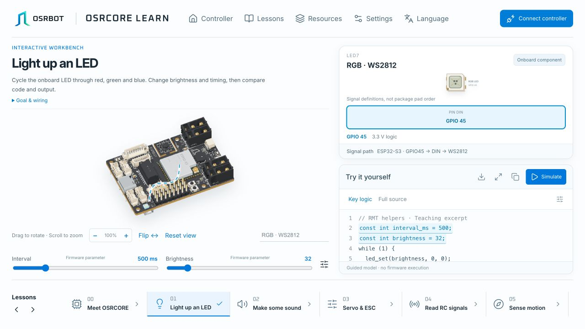

# OSRCORE Learn

[简体中文](README.zh-CN.md) · **[Interactive tutorials](https://osrbot.github.io/osrcore-learn/)** · [Hardware resources](#hardware-resources)

OSRCORE is an ESP32-S3 robot controller. This repository provides its interactive tutorials, interface references and ESP-IDF examples.

Explore interfaces, read sensors and control motors, then combine these capabilities into a robot control program.

*The interactive tutorial workspace, available in English and Simplified Chinese.*

## Learn online

- **Explore the controller**: rotate and zoom the 3D model, select connectors, headers and onboard components, and inspect pin and signal definitions.
- **Run lesson simulations**: adjust lesson parameters and observe changes in the code, indicators and output.
- **Program a robot**: use the accompanying ESP-IDF examples to learn sensing, communication, motion control and multitasking.

## Lessons and source

14 lessons, including 13 ESP-IDF firmware examples. Select a title to browse its source or hardware reference.

| Lesson | Topic |
|---|---|
| 00 | [Meet OSRCORE](materials/) |
| 01 | [Light up an RGB LED](01_blink_led/) |
| 02 | [Make the buzzer sound](02_buzzer/) |
| 03 | [Control servos and ESCs](03_pwm_servo/) |
| 04 | [Receive RC signals](04_sbus_rc/) |
| 05 | [Sense motion](05_imu_i2c/) |
| 06 | [Measure rotational speed](06_encoder/) |
| 07 | [Save parameters](07_nvs/) |
| 08 | [Run multiple tasks](08_freertos/) |
| 09 | [Closed-loop motor control](09_pid_motor/) |
| 10 | [Estimate attitude](10_ahrs/) |
| 11 | [Find your heading](11_mag_compass/) |
| 12 | [Build a robot](12_full_example/) |
| 13 | [Check controller functions](13_factory_demo/) |

## Hardware resources

[Product manual](https://osrbot.github.io/osrcore-learn/hardware/manual-en.pdf) · [Schematic](https://osrbot.github.io/osrcore-learn/hardware/schematic-en.pdf) · [PCB and interface references](materials/)

---

**OSRBOT · Open Source Robotics**

[www.osrbot.com](https://www.osrbot.com) · [winter@osrbot.com](mailto:winter@osrbot.com)
